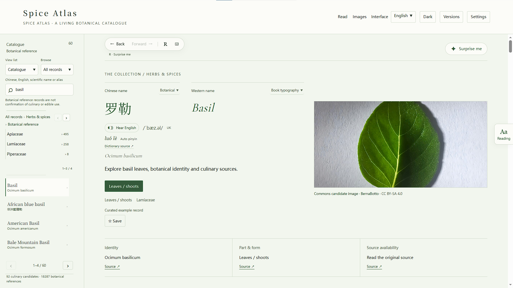

# 香料图鉴-SpiceAtlas

English · [简体中文](README.zh-CN.md) · [User guide](docs/USER_GUIDE.en.md) · [MIT licence](LICENSE)

**A botanical reading desk for the ingredients behind everyday cooking.**

SpiceAtlas brings a searchable local catalogue, source-linked encyclopedia reading and ingredient images into one calm interface. Explore names and plant relationships, compare material forms, and follow a reference back to its original page. The project combines a Python service, a SQLite collection and a browser interface with English, Simplified Chinese and Traditional Chinese support.



*English example: Basil. Screenshots supplied by the project owner retain source credits; they do not change the default startup ingredient. [Capture details and attribution](docs/screenshots/README.md).*

## What the current system does

| Area | Capabilities |
| --- | --- |
| Local discovery | Chinese/English/scientific-name and alias search, bounded spelling matching, hierarchical navigation, favourites and browsing history |
| Traceable reading | Wikipedia focus/full articles, language-link resolution, headings, citations, original hyperlinks and reviewed botanical source adapters |
| Ingredient images | Automatic Commons lookup, separate material/packaging filters, thumbnail/source/licence cards and original search links |
| Languages & translation | Auto / English / Simplified / Traditional interface modes; configurable LM Studio-compatible, Google Cloud and Azure translation for up to eight focus paragraphs |
| Personal collections | Named, editable workspaces with separate catalogues, settings, caches and logs; copy, switch, reorder, recover deleted workspaces |
| Reading experience | Independent article typography, light/dark themes, four motion levels, operation Back/Forward, random exploration and configurable paging shortcuts |
| Desktop operation | Windows background launcher, progress/details panel, tray controls and pause/resume notifications; console startup on macOS/Linux |
| Incremental upgrades | Manifest checks, original-folder updates, program backups and failure rollback while retaining personal data and the dependency environment |

The baseline contains **18,379 records**: **92 culinary candidates** and **18,287 botanical references**. These are not 18,379 verified edible spices. Thirteen examples have curated presentation fields; uncertain culinary identity remains explicit. The cleaning audit retains 699 exclusion, review and exact-identity merge decisions. Catalogue metadata was imported on 27 October 2026, with cleaning evidence obtained on 28 October; live sources have their own fetch times.

## A closer look

The full-width reader keeps its chapter outline above the article. Chinese and Western nameplates sit beside pronunciation near the top; each workspace can save its preferred typography. The **Aa** edge tab changes article size and spacing without scaling the whole interface. System reduced-motion preferences take priority over the four motion levels.

“Versions” in the application are editable **collection workspaces**, separate from application release numbers. Each keeps its own catalogue, settings, favourites, history, resource cache and operation counts. The manager registry and program-upgrade history sit outside these workspaces. Retained online resources keep their original source and fetch time; Refresh requests a newer copy.

## Run on your computer

This public repository distributes the local application; it is not a hosted web service. Python **3.11+** is required. First installation and new online references need internet access. Node.js is optional for developer UI checks.

**Windows:** extract the complete package into a writable directory and double-click **`run.cmd`**. Python with Tcl/Tk is needed for the desktop window. Startup stages appear before the browser opens; the service stays in the tray. Single-click the tray icon to show/hide the window, double-click to open the page, and use its menu to pause, resume or **Stop service & exit**. `run_console.cmd` provides a visible diagnostic fallback.

**macOS / Linux:** run `sh run.sh` and keep its terminal open. Ctrl+C stops the service.

For a source checkout:

```bash
git clone https://github.com/Bravoll/SpiceAtlas.git
cd SpiceAtlas
uv sync --frozen --inexact
uv run --no-sync python launch.py
```

Without uv, create a Python virtual environment, install `requirements.txt`, and run `python launch.py`. The default address is <http://127.0.0.1:8765>; an occupied port may cause the launcher to select a nearby free one. Open the address it reports. Opening `index.html` directly cannot use the backend.

**Already using v0.6 or the previous v0.7 candidate?** Stop the old service, extract the new patch/full package elsewhere, run **its** `Update_Atlas.cmd`, and select the original installation directory. Keep the original path and `.venv`; do not replace your `data/` directory with a fresh baseline. [In-place upgrade guide](docs/UPGRADING.en.md). The updater accepts complete migration chains, but this release includes only the real 0.6→0.7 step and supported 0.7 revisions; future versions and automatic GitHub downloading are not implemented.

## How it fits together

| Component | Responsibility |
| --- | --- |
| Browser · HTML/CSS/JavaScript | Local catalogue UI, reading states, source cards, image references, accessible controls and motion |
| FastAPI service | Workspace-scoped APIs, sanitization, source/translation adapters, diagnostics and bounded requests |
| SQLite & local files | Catalogues, identity evidence, settings, history, caches, resumable imports and audit logs |
| Desktop launcher | Dependency preparation, owned service lifecycle, readiness checks, tray/window and live process log |
| External providers | Wikipedia / Commons / Wikidata, GBIF and reviewed websites; optional configured translation services |

Typing in the main search box queries local data. Selecting a record fetches online content. Idle warming retains frequently used references and favourites; depth-one predictions use bounded RAM. Source adapters have timeouts, reject stale responses, and keep links and provenance. A website without an official API is described as an HTML adapter, not an API.

## Sources, translation and practical boundaries

- **Wikipedia:** dedicated language controls resolve linked language editions and try identity-checked search when necessary. Missing Chinese can fall back to English. Other sources keep their separate preferred/secondary-language rows. Only automatically detected Simplified Chinese uses the domestic source order; manual language choices use the international order.
- **Images:** actual search terms are visible. Publicly readable search metadata can produce image cards, but Google/Baidu may return verification or dynamic pages. The latest Google Images probe returned no extractable images. Original-site links remain available. The [optional split helper](browser_helper/README.md) requires actual browser extension API support and is not installed automatically; it was fixture-tested, not installed/native-tested here.
- **Translation:** configure your own LM Studio / OpenAI-compatible endpoint, Google Cloud Translation or Azure Translator. Original and bilingual focus-paragraph views are supported. Full-article batch translation is not implemented; machine output needs checking. No translation key or local model is bundled.
- **Pronunciation:** available dictionary IPA/UK recordings retain their sources; browser speech prefers `en-GB`. Voice availability depends on the device. Mandarin pinyin is generated locally and labelled automatic. Latin scientific names are not synthesized.
- **Content quality:** botanical relatedness does not establish flavour equivalence, substitution or edibility. Source availability and copyright remain provider-specific. Website verification and framing restrictions are respected.

Personal keys, editable workspaces, caches, logs and downloaded media are excluded from Git and release bundles. Settings APIs hide saved secret values. Keep the local service on loopback and do not share personal workspace folders. See the [user guide](docs/USER_GUIDE.en.md) for source order, translation setup, caching, shortcuts and import controls.

## Project, licence and development

Created and maintained by **[Bravoll](https://github.com/Bravoll)** for learning, engineering practice and botanical/cooking curiosity. Original application code, icons and original documentation use the **[MIT License](LICENSE)**; MIT permits commercial reuse with its notice requirements. The project's educational purpose is not an extra noncommercial restriction.

Third-party encyclopedia text, taxonomy data, photographs, audio, fonts and dependencies retain their own terms. A search/API response is not a reuse licence. Read [content notices](CONTENT_LICENSES.md), the [Chinese licence explanation](LICENSE.zh-CN.md) and [screenshot attribution](docs/screenshots/README.md) before reusing those materials.

- [Full user guide](docs/USER_GUIDE.en.md) · [中文使用指南](docs/USER_GUIDE.zh-CN.md)
- [Chinese development guide](development.md) · [Cache design](docs/CACHE_DESIGN.zh-CN.md) · [Motion design](docs/MOTION_DESIGN.zh-CN.md)
- [Version history](CHANGELOG.md) · [Roadmap](docs/ROADMAP.zh-CN.md) · [Source research](docs/SOURCE_RESEARCH_v0.7.zh-CN.md)

```bash
uv run --no-sync python -m unittest discover -s tests -q
npm ci
npm run test:ui
```

Verification records **215 backend tests**, **127 UI checks**, responsive Chrome observations and isolated actual-ZIP upgrades from v0.6 / the previous v0.7 candidate. See `data/verification_v07.json`. `npm run dev` is a labelled synthetic QA preview, not the Python service. Windows native UI, default-browser association, personal translation credentials, audible speech and 120 Hz rendering remain target-device checks.

## What's new in v0.7

- Added bounded catalogue regions, stable paging controls, custom shortcuts and settings-only catalogue management.
- Added persistent notification cards, pre-pause/resume notices, a 2-second diagnostic publication deadline and periodic rechecks.
- Added parallel “Other sources” cards, reviewed adapters, Wiki language resolution and reading/translation concurrency fixes.
- Added per-workspace operation statistics, idle warming, retained resource packets and memory-only predictions.
- Refined theme/text transitions, popup entry/exit, full-width reading, top nameplates and aligned Wiki/language controls.
- Added in-place updates and small patches, image-query labels, public image metadata parsing and the optional native split helper.
- Published bilingual project documentation, attributed interface screenshots and a source-code MIT licence. Startup defaults remain unchanged.

[Complete v0.7 changes and earlier releases →](CHANGELOG.md)
